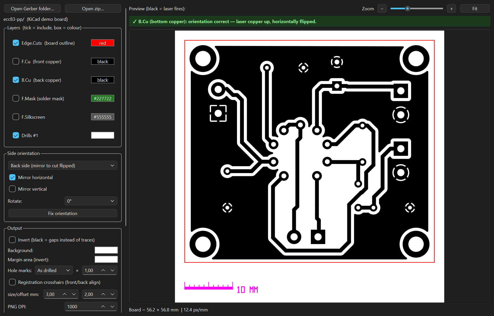

# gerber2laser

Turn Gerber files into laser-ready artwork (PNG or SVG) for making PCBs with a
**CO2 laser cutter**, using **laser-resist etching**: paint the board, let the
laser burn the paint off, etch away the bare copper.

Works with Gerbers from KiCad or any other PCB tool. It has a GUI, a scriptable
command line, and an optional KiCad toolbar button.

> **The one rule:** in every output file, **black = laser fires = paint removed
> = copper etched away.** The **Invert** checkbox decides whether that is your
> traces or your gaps ([user guide](docs/user-guide.md#how-it-works)).



## Quick start

**1. Install.** You need Python 3.9 or newer. Each installer builds its own
virtualenv, so your system Python is left untouched, and adds a desktop item
and a menu entry:

```powershell
powershell -ExecutionPolicy Bypass -File install\windows\install.ps1   # Windows
```
```bash
./install/macos/install.command      # macOS  -> ~/Applications/gerber2laser.app
./install/linux/install.sh           # Linux  -> ~/.local/bin + .desktop entry
```

Or run it straight from the repo:

```bash
pip install -r requirements.txt
python gerber2laser.py
```

**2. Make a board.**

1. Export Gerbers from your PCB tool. In KiCad: *Plot → Gerber*, with F.Cu,
   B.Cu and Edge.Cuts, plus drill files if you want drill marks.
2. **Open Gerber folder** (or **Open zip**). Tick the layers you want.
3. Pick **Front** or **Back**. For a double-sided board, tick **Registration
   crosshairs**.
4. Check the preview, where black shows what burns. Set **Invert** to match your
   process.
5. Calibrate kerf once ([kerf and calibration](docs/kerf-calibration.md)), then
   **Export PNG** or **Export SVG**.

Scripting it instead: [docs/cli.md](docs/cli.md).

## Docs

| Doc | Read it for |
|---|---|
| [docs/user-guide.md](docs/user-guide.md) | How laser-resist etching works, and every GUI control: invert, front/back, orientation, registration, preview, drill marks, scale bar |
| [docs/kerf-calibration.md](docs/kerf-calibration.md) | Kerf compensation and finding your number with the calibration coupon |
| [docs/output-formats.md](docs/output-formats.md) | PNG vs SVG, importing into LightBurn, export file names, limits |
| [docs/cli.md](docs/cli.md) | The command line: every option, with examples |
| [docs/kicad-plugin.md](docs/kicad-plugin.md) | The optional pcbnew "Gerber → Laser" button |
| [install/README.md](install/README.md) | What the installers do, per OS, and how to uninstall |
| [TODO.md](TODO.md) | Open work |
| [CLAUDE.md](CLAUDE.md) | Architecture, design rules and verification, for contributors |
| [docs/moves.md](docs/moves.md) | Log of moved or renamed files |

## Repo map

| Path | What it is |
|---|---|
| `gerber2laser.py` | The whole application: GUI, CLI and KiCad plugin in one file |
| `install/` | Per-OS installer wizards |
| `assets/` | App icon; the PNG/ICO/ICNS are generated from `assets/gerber2laser.svg` |
| `tools/` | Developer scripts, one folder per job: `tools/icons/make_icons.py` rebuilds the icon set, `tools/screenshots/make_screenshots.py` the screenshots |
| `tests/` | pytest suite for the Qt-free core; `tests/conftest.py` builds a real test board |
| `docs/` | User and reference docs (see Docs above); screenshots in `docs/images/` |
| `.githooks/` | Pre-commit layout check (`.githooks/layout_check.py`, settings in `.layout.json`) |

## Development

```bash
pip install -r requirements.txt -r requirements-dev.txt
python -m pytest tests -q              # no display needed
git config core.hooksPath .githooks    # once per clone: turns on the layout check
```

## License

MIT, see [LICENSE](LICENSE).
