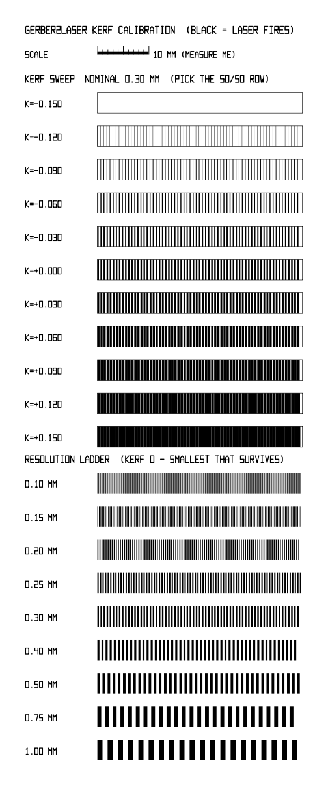

# Kerf and calibration

## Kerf / expansion

Etching undercuts copper and the laser has a finite spot, so the burned region
never comes out exactly the width of the geometry. The **Kerf/expand mm** slider
compensates by growing the black region by that amount, or shrinking it when
the value is negative:

- Positive, with *"expand grows the BLACK region"* ticked: the black burn area
  grows.
- Negative: black shrinks, so more copper is kept.

Kerf is a **per-edge** offset: a value of `k` moves every black boundary out by
`k` mm (or in, if negative), so a bar's width changes by `2k`.

Kerf applies **only to the raster output**: the PNG export and the raster
preview. The **SVG export never contains kerf**; it is the exact Gerber geometry.
For vector cuts, apply kerf in LightBurn, which has a kerf offset per cut layer.
The GUI greys the kerf controls out while the vector preview is selected, as a
reminder.

## Calibration (find your kerf number)

The **Calibration** panel offers two methods.

**1. Kerf calibration coupon (recommended: one burn, no maths).** This generates
a test card with:
- a **kerf sweep**: the same line/space comb repeated, each row with a different
  kerf baked in and labelled (`k=+0.03` …),
- a **resolution ladder**: combs from 0.1 to 1.0 mm, showing the finest
  trace/space your process resolves,
- a true **10 mm scale bar**, to check the laser's absolute scaling.

Export the coupon as PNG or SVG (CLI: `--coupon`) and run it once through your
*exact* paint → laser → etch process. Then look at the sweep: the row whose
**black bars and white gaps come out equal width (50/50)** is your compensation.
Set the main **Kerf** slider to that row's `k`. Calipers are optional; judging
50/50 by eye is usually enough.

**2. Set kerf from a measurement.** Burn one feature at kerf 0 and measure it
with calipers. Enter the nominal and measured widths, and say whether you
measured the black feature or the gap. The tool computes the per-edge kerf and
sets the slider to it.
