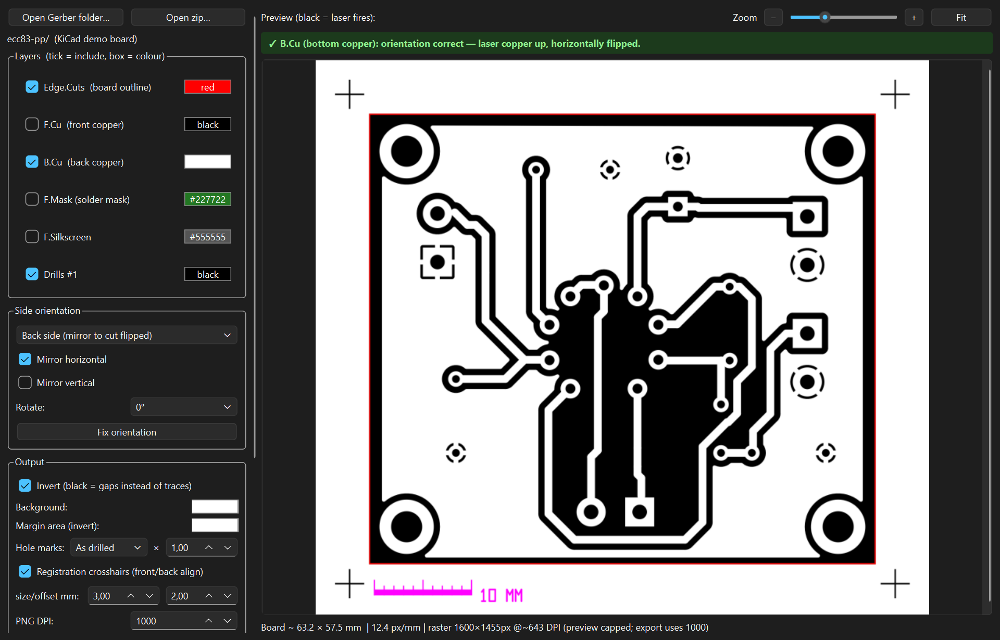

# User guide

How the process works and what each GUI control does. Kerf and calibration
have their own guide: [kerf-calibration.md](kerf-calibration.md).

## How it works

A CO2 laser (10.6 µm) **cannot cut or engrave copper**, because copper reflects
that wavelength. The home method that works is laser-resist etching:

1. Spray the copper-clad board with **matte black paint**.
2. The laser **ablates the paint wherever the image is black**.
3. Chemically etch the board (ferric chloride or cupric chloride). Bare copper
   dissolves and painted copper survives.

So in every output file: **black = laser fires = paint removed = copper etched
away.**

Whether black should be your **traces** or the **gaps** depends on your process,
and the **Invert** checkbox flips it. By default the traces are black: their
paint burns off, so the traces etch away. Most people want the opposite: tick
Invert so the gaps burn and the traces stay copper. Burn one test coupon and keep
whichever setting matches.

When Invert is on, only the **board area** becomes the burn field. The margin
around it keeps its own colour, white by default, so you don't burn the paint
off the whole sheet. Change it with the **Margin area (invert)** button in the
GUI, or `--invert-margin` on the CLI. Registration crosshairs automatically pick
black or white to contrast with the margin colour.

## Loading files

**Open Gerber folder** or **Open zip**. Files are classified by **filename**:
KiCad `-F_Cu.gbr` / `-B_Cu.gbr` / `-Edge_Cuts.gbr`, legacy `.gtl/.gbl/.gko`,
drills `.drl`, plus silk and mask layers. So a normal Gerber export from any
tool just loads. Copper and outline layers are switched on automatically; silk,
mask and drills are offered as optional layers.

From KiCad: *Plot → Gerber* with F.Cu, B.Cu and Edge.Cuts, plus drill files if
you want drill marks.

## Front vs back

You always laser the side that is **face up**. To do the back copper you
physically flip the board over, so the back geometry must be **mirrored** or it
won't line up with the vias and the board edge.

- **Side = Front**: no mirror.
- **Side = Back**: horizontal mirror is switched on automatically.
- `Rotate` and `Mirror H/V` are exposed manually for unusual jigs.
- Mirror is about the board centre, so the outline stays put and only the
  content flips. Front and back share the same reference frame.

## Cut-orientation indicator (don't etch a mirrored board)

On load, the tool works out which copper side actually has geometry, sets the
correct cut orientation automatically, and shows a banner:

- **F.Cu (top copper)**: cut **as-is**. You laser the top face with it up,
  which matches the Gerber's top-down view.
- **B.Cu (bottom copper)**: cut **horizontally flipped**. You turn the board so
  the bottom copper faces up, which is the mirror of the top-down Gerber.

The rule keys off **which copper layer holds the geometry**, not off how many
layers the board has. A single-sided board laid out on F.Cu is cut as-is; one
laid out on B.Cu is flipped. When both sides have geometry, the tool picks
**top** and leaves B.Cu unticked, because each side is a separate burn.

A green banner means the orientation is correct for the enabled copper layer.
An amber one means it is the wrong way round: hit **Fix orientation**, or use the
Front/Back selector. If both copper sides are enabled at once, it warns you.

## Front/back registration (double-sided)

Tick **Registration crosshairs** and four `+` targets are drawn just outside the
board corners. They live in the board's own coordinate frame, so they mirror and
rotate with everything else. After you flip the board, they land on the **same
physical spot on both sides**.

Burn them into the paint on each side and use them to line the board up on the
laser bed for the second burn. They also work as a drilling and alignment
reference. You can adjust their size and outward offset.

## Preview

The **Preview mode** selector sits in the Output panel, under the kerf controls:

- **Vector (fast)**: a live SVG, good for checking layout and colours. Vector
  output never includes kerf, so the kerf controls are greyed out in this mode.
- **Raster (true DPI + kerf)**: renders exactly what the PNG export produces at
  your chosen DPI, including kerf. The preview is pixel-capped for speed; the
  export uses full DPI.

The preview opens fit-to-window.
- **Drag** to pan.
- The **mouse wheel** zooms about the pointer; hold **Ctrl** for bigger steps.
- **Double-click** zooms in on what you clicked, bringing it to the middle of
  the view; **Ctrl+double-click** zooms back out.
- There is also a slider, **+ / −** and **Fit**. Vector mode stays sharp at any
  zoom.

## Drill marks

Drills never have a colour of their own. They come out the **opposite** of the
copper (or of the background when no copper layer is on) and are drawn last, so
a hole punches through and reads as a hole whichever way **Invert** is set. To
override this, pick a colour on the drill row by hand.

**Hole marks** sets their size:
- *As drilled* keeps each hole's real diameter.
- Pick one diameter from the list to make every hole the same dot.

The multiplier then scales that size: shrink the holes to centre punches, or
enlarge them so the laser actually clears them. On the CLI, use `--drill-size`
and `--drill-scale`.

## Scale bar (size check)

The **Scale bar** is on by default; untick it, or use `--no-scale-bar`. It is a
true-length ruler (10 mm by default, with 1 mm ticks) below the board, and it
keeps its own clearance from the board and the frame even at margin 0. With
registration crosshairs on, it sits **level with the bottom-left mark**, just to
its right, so it adds **no extra output size**. Without the marks, it adds a
shallow band of its own below the board.

It is drawn **after** the mirror/rotate, so it always reads left to right at its
exact length. It is also its own SVG group (`id="scale-bar"`) in its **own
colour** (magenta by default). In LightBurn, map that colour to a no-output layer
so it isn't burned, or delete the group in any editor. Measure the bar in
LightBurn, or on a test burn, to confirm the board comes out at true size before
committing to a full etch.

## Exporting

**Export PNG** or **Export SVG**. Which to pick, how LightBurn reads them and how
the files are named: [output-formats.md](output-formats.md).
